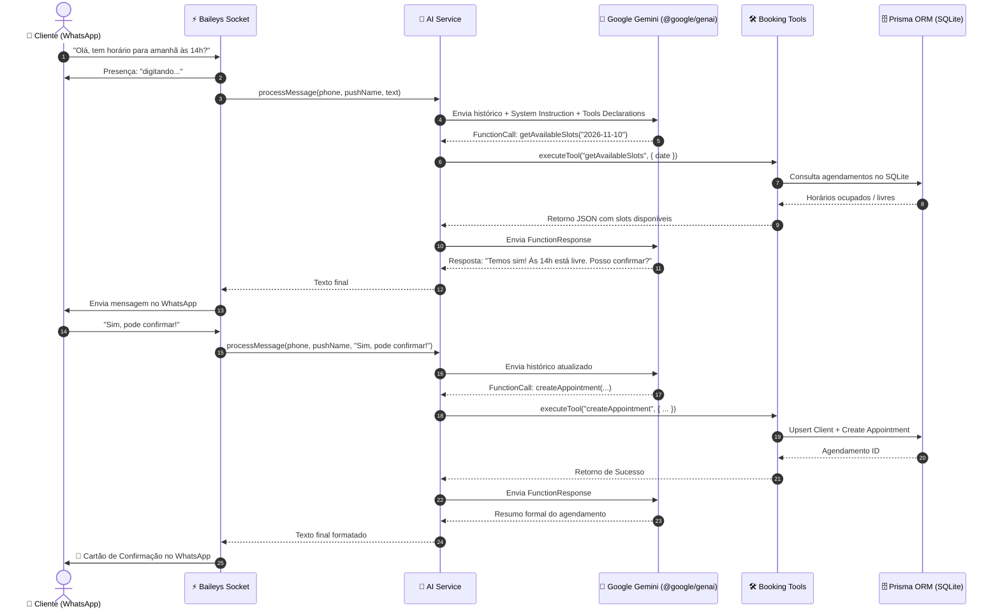

# 💈 WhatsApp AI Barber Booking Bot (Google Gemini)

> Bot de WhatsApp inteligente e autônomo para agendamento de horários em barbearias e salões, desenvolvido com **Node.js**, **TypeScript (Strict Mode)**, **@whiskeysockets/baileys**, **Google Gemini (@google/genai)** com **Tool / Function Calling nativo** e **Prisma ORM** com **SQLite**.

---

## 🌟 Visão Geral do Projeto

Este projeto foi desenhado com padrões arquiteturais de nível sênior, com foco em robustez, manutenibilidade e separação clara de responsabilidades (*Clean Architecture*). Ele simula uma recepcionista virtual humanizada e cordial que:

1. Mantém o contexto da conversa em memória por número de WhatsApp.
2. Consulta o catálogo de serviços e preços em tempo real no banco de dados.
3. Verifica horários livres entre 09:00 e 18:00 para qualquer data solicitada.
4. Converte expressões temporais relativas ("amanhã à tarde", "próxima sexta") para datas exatas.
5. Pede confirmação explícita do cliente antes de efetivar o agendamento.
6. Registra ou atualiza o cliente e cria o agendamento no banco de dados SQLite via **Tool Calling nativo do Google Gemini**.
7. Envia feedback visual de digitação ("digitando...") no WhatsApp durante o raciocínio da IA.

---

## 🏗️ Arquitetura e Fluxo de Execução



---

## 🛠️ Stack Tecnológica

| Camada | Tecnologia | Justificativa Técnica |
| :--- | :--- | :--- |
| **Runtime** | Node.js (v20+ / v22+ / v24+) | Alta performance I/O orientada a eventos. |
| **Linguagem** | TypeScript 5.8+ (*Strict Mode*) | Prevenção de bugs em tempo de compilação, tipos estritos e código autodocumentado. |
| **Conexão WhatsApp** | `@whiskeysockets/baileys` | Biblioteca moderna baseada em WebSockets puros, sem emuladores pesados de navegador (Puppeteer/Chromium). |
| **Sessão & QR Code** | `useMultiFileAuthState` + `qrcode-terminal` | Persistência local segura das credenciais criptográficas em disco com reconexão resiliente. |
| **ORM & Database** | Prisma ORM + SQLite | Modelagem fortemente tipada, migrações declarativas e zero necessidade de setup de servidor externo. |
| **Provedor de IA** | Google Gemini (`@google/genai`) | SDK oficial do Gemini com suporte de ponta a Function / Tool Calling estruturado (`gemini-2.5-flash`). |

---

## 📁 Estrutura de Pastas

```text
├── auth_info_baileys/     # Sessão persistida do WhatsApp (gerada após escanear QR Code)
├── prisma/
│   ├── dev.db             # Banco de dados local SQLite
│   └── schema.prisma      # Modelagem declarativa das tabelas
├── src/
│   ├── config/
│   │   ├── env.ts         # Validação e tipagem de variáveis de ambiente
│   │   ├── prisma.ts      # Instância singleton do Prisma Client
│   │   └── ai.ts          # Inicialização do cliente Google Gemini (@google/genai)
│   ├── database/
│   │   └── seed.ts        # Script para popular serviços padrão da barbearia
│   ├── tools/
│   │   └── bookingTools.ts# Implementação de regras de negócio e Function Declarations
│   ├── services/
│   │   ├── ai.ts          # Orquestração do Gemini, histórico em memória e Tool Loop
│   │   └── whatsapp.ts    # Conexão Baileys, reconexão e manipulador de eventos
│   └── index.ts           # Ponto de entrada e encerramento gracioso (Graceful Shutdown)
├── .env.example           # Modelo de variáveis de ambiente
├── package.json           # Dependências e scripts npm
├── tsconfig.json          # Configurações estritas do TypeScript
└── README.md              # Documentação completa do projeto
```

---

## 🚀 Como Executar o Projeto

### 1. Obter a Chave do Gemini
Gere uma chave gratuita no **Google AI Studio**:
👉 [https://aistudio.google.com/apikey](https://aistudio.google.com/apikey)

### 2. Configurar o `.env`
No arquivo `.env`, preencha sua chave:
```env
DATABASE_URL="file:./dev.db"
GEMINI_API_KEY="sua_chave_do_google_ai_studio_aqui"
GEMINI_MODEL="gemini-2.5-flash"
BOT_NAME="Sophia"
BARBERSHOP_NAME="Barbearia Estilo & Navalha"
```
*(O código também reconhece automaticamente se a variável estiver nomeada como `API_KEY` ou `GOOGLE_API_KEY`)*.

### 3. Sincronizar Banco e Popular Serviços
```bash
npx prisma db push
npm run seed
```

### 4. Iniciar o Bot
```bash
npm run dev
```

1. O terminal exibirá o **QR Code**.
2. Abra o WhatsApp no seu smartphone > **Aparelhos Conectados** > **Conectar um aparelho**.
3. Aponte a câmera para o QR Code no terminal.
4. O bot estará online e pronto para receber mensagens e agendar clientes!

---

## 📜 Licença
Distribuído sob a licença **MIT**.
